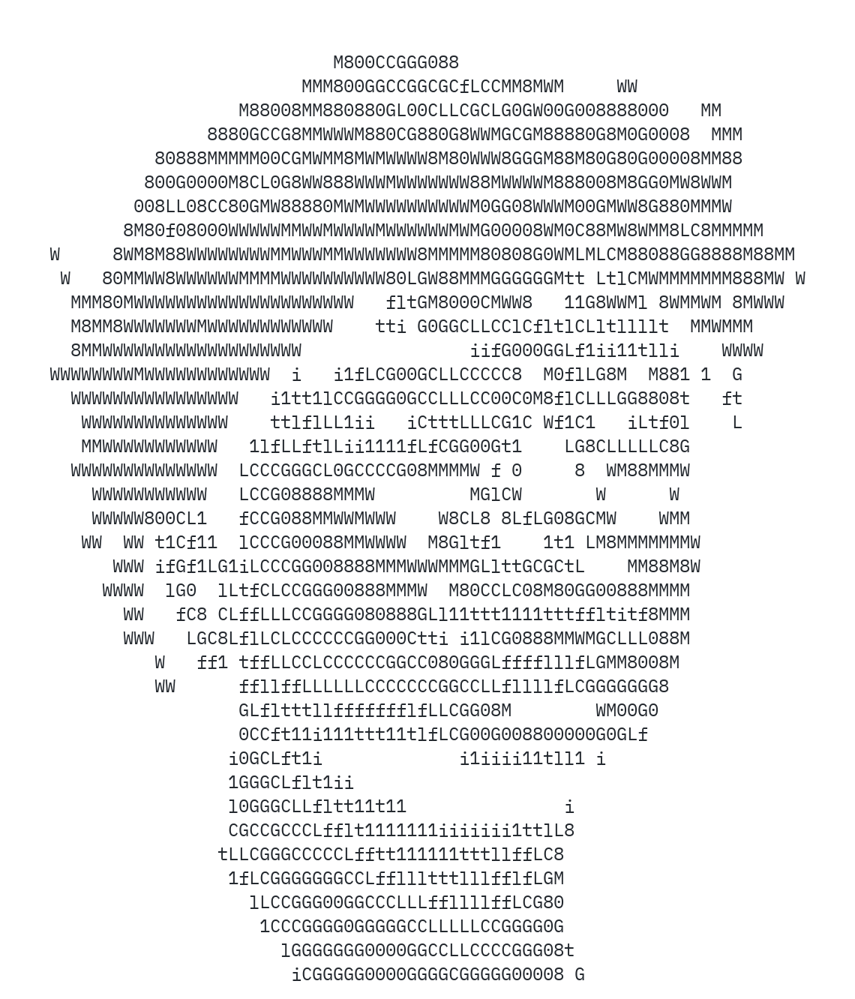

<!-- portrait:start -->

  <picture>
    <source media="(prefers-reduced-motion: reduce) and (prefers-color-scheme: dark)" srcset="./assets/portrait/portrait-dark.png" />
    <source media="(prefers-reduced-motion: reduce) and (prefers-color-scheme: light)" srcset="./assets/portrait/portrait-light.png" />
    <source media="(prefers-color-scheme: dark)" srcset="./assets/portrait/portrait-dark.gif" />
    <source media="(prefers-color-scheme: light)" srcset="./assets/portrait/portrait-light.gif" />
    
  </picture>

<!-- portrait:end -->

<h1 align="center">Rijan Ghimire</h1>

  Software engineer building mathematical software, developer tools, and macOS apps. 
  <a href="https://www.rijan.sh">Website</a> ·
  <a href="https://www.linkedin.com/in/rijan-ghimire-37ba4a2b0/">LinkedIn</a> ·
  <a href="mailto:contact@rijan.sh">Email</a>

I study Computer Engineering and Mathematics at [Southern Miss](https://www.usm.edu/).

## Selected work

<!-- projects:start -->
<h3><a href="https://github.com/Luseefor/vinculum">Vinculum</a></h3>

A local-first math editor for equations, curves, surfaces, and vector fields in 2D and 3D. Save work in your browser or share a scene by URL.

<a href="https://vinculum.rijan.sh">Website</a> · <a href="https://github.com/Luseefor/vinculum">Source & documentation</a>

<h3><a href="https://github.com/Luseefor/LumaWall">LumaWall</a></h3>

Video wallpapers from local files on macOS, with per-display playback, scheduled playlists, and power-aware controls. Available to build locally.

<a href="https://github.com/Luseefor/LumaWall">Source & documentation</a>

<h3><a href="https://github.com/Luseefor/faredelta">FareDelta</a></h3>

Flexible-date flight search with fare history, saved routes, and price alerts, using cached fare observations.

<a href="https://faredelta.rijan.sh">Website</a> · <a href="https://github.com/Luseefor/faredelta">Source & documentation</a>
<!-- projects:end -->

[All repositories](https://github.com/Luseefor?tab=repositories)

## Engineering notes

In Vinculum, TypeScript validates expressions and Rust/WASM evaluates bounded numeric programs. Grid sampling is tiled to cap each call at 2,048 samples, while saved scenes keep their existing format.

[Read the Rust/WASM implementation note](https://github.com/Luseefor/vinculum/blob/master/docs/architecture/rust-wasm-boundary.md).

## Contributions

<picture>
  <source media="(prefers-color-scheme: dark)" srcset="https://raw.githubusercontent.com/Luseefor/Luseefor/output/github-snake-dark.svg" />
  <source media="(prefers-color-scheme: light)" srcset="https://raw.githubusercontent.com/Luseefor/Luseefor/output/github-snake.svg" />
  
</picture>

Recent merged work and releases

<!-- recent-work:start -->
- <a href="https://github.com/Luseefor/Automater/pull/3">Add Tandem automation panels, reliable playback and clipboard tools</a> 
  2026-10-19 · Luseefor/Automater #3

- <a href="https://github.com/Luseefor/vinculum/pull/12">Promote reviewed v0.5.1 changes to production</a> 
  2026-10-17 · Luseefor/vinculum #12

- <a href="https://github.com/Luseefor/vinculum/pull/11">Improve 2D/3D graph workflows, dark theme and dependency safety</a> 
  2026-10-17 · Luseefor/vinculum #11

- <a href="https://github.com/arpan404/ace/pull/903">Split daemon Store by storage responsibility</a> 
  2026-10-17 · arpan404/ace #903
<!-- recent-work:end -->

Updated daily from public GitHub activity.

